# FinBoard Fluent · 财观

FinBoard Fluent 是 [FinBoard](https://github.com/Urtaome0211/FinBoard) 的桌面界面重构版：业务层、数据层和数据库保持一致，主窗口、导航、标题栏、提示条使用 **PySide6-Fluent-Widgets** 重新搭建，视觉上更接近 Windows 11 的原生应用。5.3 把页面、对话框、表格、表单和分段控件全部换成 Fluent 组件，原生文本输入弹窗也改为 Fluent `TextPromptDialog`，并修复了深色主题切换时侧边栏短暂发白的问题。5.3.1 进一步支持 A 股、港股和美股/ETF 行情，兼容裸代码、交易所前后缀和 USD/HKD 持仓。5.4.0 汇总 Fluent 控件重写与多市场行情修复，作为正式发布版。5.4.1 修复全部卖出时持仓数量归零触发 CHECK 约束的问题，schema 升到 19。

- 版本：**5.4.1**
- 技术栈：Python 3.10+、PySide6 6.6+、PySide6-Fluent-Widgets 1.11.3
- 平台：Windows 10/11（macOS/Linux 可运行源码，但未做安装包验证）
- 数据：与 FinBoard 5.0 **共用同一个 SQLite 数据库**（schema 19）
- 许可：MIT

> 5.4.0 已发布：[GitHub Release v5.4](https://github.com/Urtaome0211/FinBoard/releases/tag/v5.4)；5.4.1 为本地卖出修复版，尚未上传。

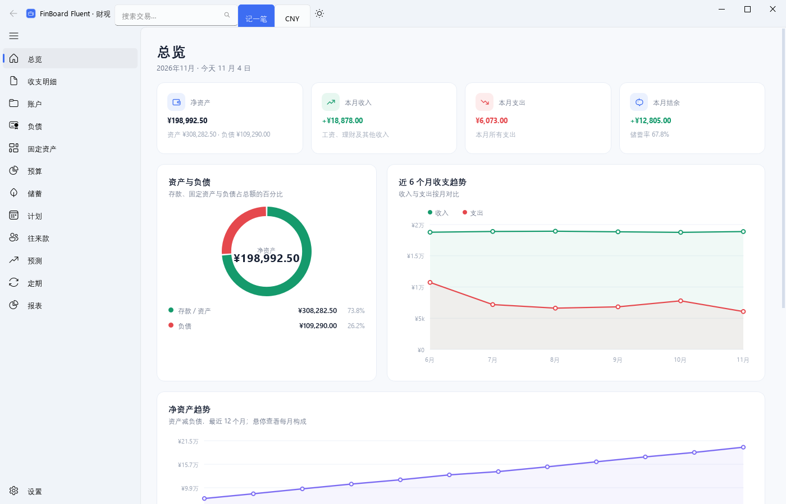

5.3 控件重写后的收支明细：

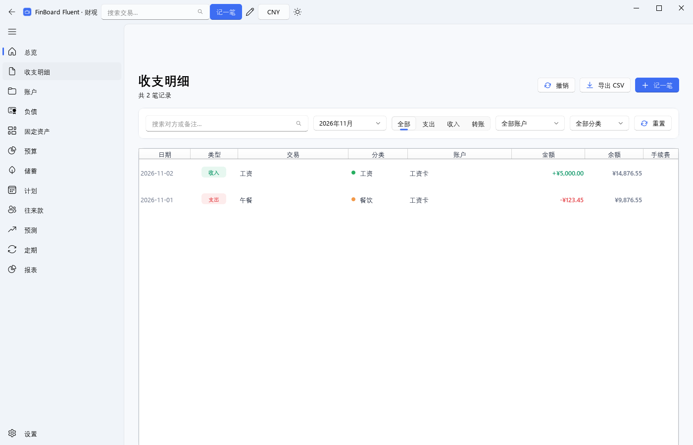

5.2 新增的行情、模板与快速记账（5.3 已统一为 Fluent 控件）：


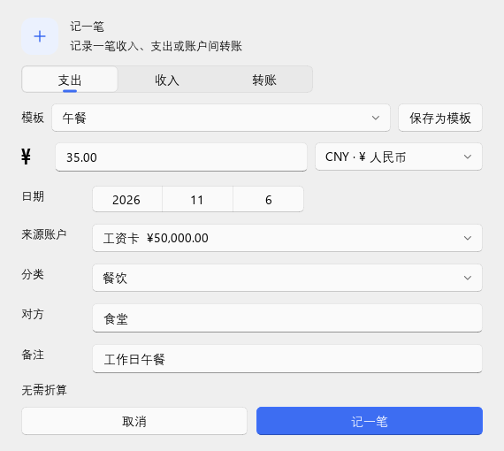


5.1 的区间报表、投资流水与负债还款：

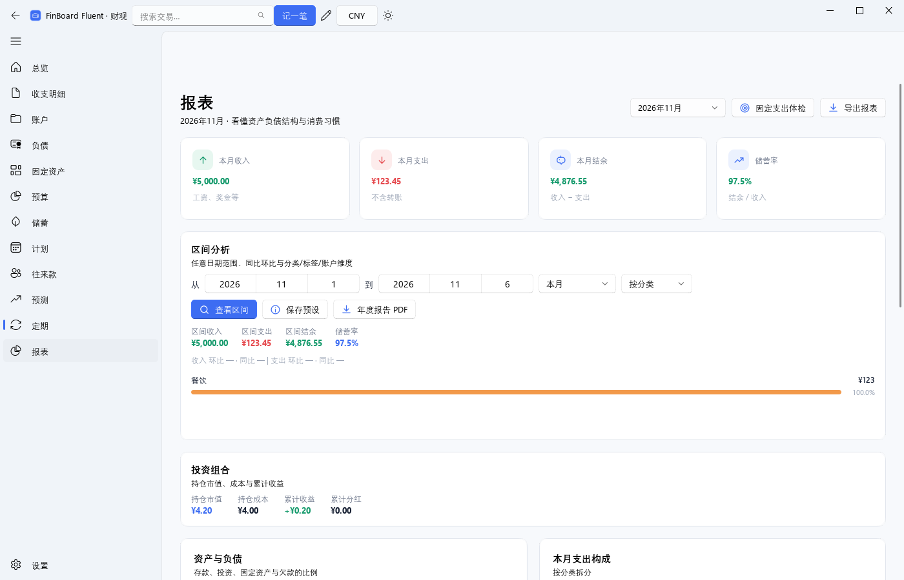
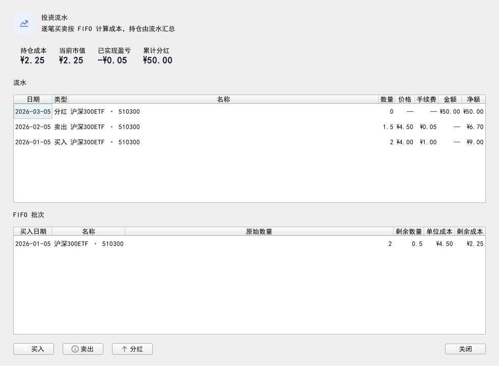
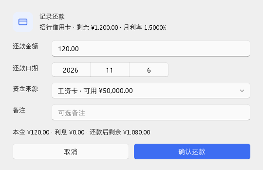

## 界面预览

| 暗色主题 | 英文界面 |
| --- | --- |
| 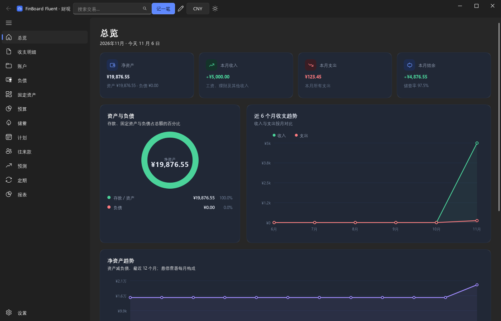 | 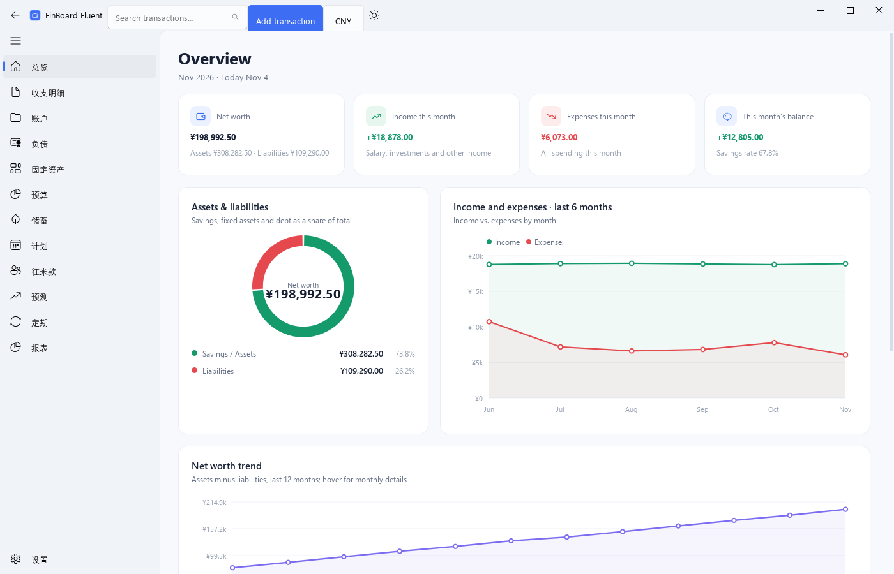 |

| 负债 | 储蓄 |
| --- | --- |
| 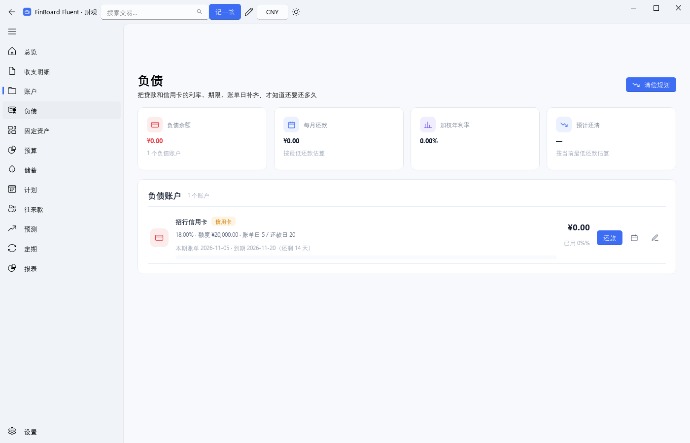 |  |

| 报表 | 设置 |
| --- | --- |
| 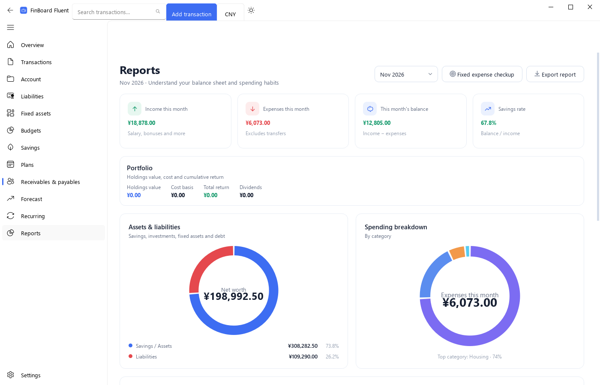 | 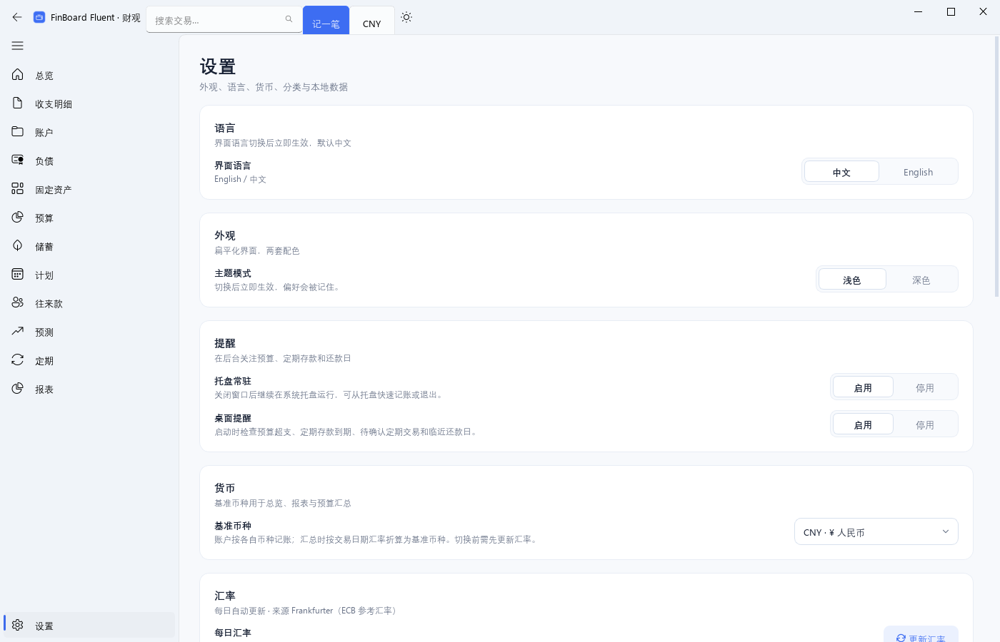 |

## 为什么做这个重构

FinBoard 5.0 的功能已经完整，但界面还是自绘 QSS 风格。5.3 把 Fluent 化推进到控件层：

- 用 `FluentWindow` + `NavigationInterface` 搭建主壳，保留 13 个页面和全部快捷键。
- 标题栏嵌入 Fluent 搜索框、主按钮、币种按钮和主题按钮；提示统一用 `InfoBar`。
- 页面、对话框、表格、输入框、下拉框、日期选择、分段控件全部通过 `fluent_controls` / `widgets` 兼容层换成 qfluentwidgets 组件。
- 卡片、页面排版和业务图表仍保留原实现：qfluentwidgets 不提供等价的图表控件，自绘图表能保持现有交互和数据结构。
- 深色主题关闭 Mica、停止 `FluentWindow` 的背景动画并立即设置纯色背景，导航和标题栏不再短暂发白。

控件兼容层的迁移成本主要在处理 `QDateEdit` → `DatePicker`、`QComboBox` → `ComboBox` 和 `localize` 的差异；详细取舍见 [BLOG.md](BLOG.md)。

## 功能

与 FinBoard 5.0 对齐，并在 5.2/5.3 增加：

- **Fluent 控件**：页面、对话框、表格、表单、日期、分段控件全部改为 qfluentwidgets，保留品牌蓝 `#3D6DF2` 与亮/暗主题。
- **深色主题**：切换后侧边栏、标题栏和卡片立即变为深色；关闭 Mica 以避免透明背景发白。
- **总览**：净资产、本月收入/支出/结余、资产负债环图、近 6 个月收支趋势、净资产趋势、投资浮盈、最近记录、预算进度。
- **收支明细**：筛选、搜索、标签、拆分、附件、批量编辑、撤销（Ctrl+Z）、退款关联、CSV 导出。
- **账户**：现金/储蓄/投资/信用卡/贷款，多币种，归档；系统自动创建的定期存款账户受保护。
- **负债**：贷款等额本息/等额本金摊还表、剩余本金、信用卡账单周期/最低还款、雪球/雪崩清偿计划；**还款记录**会拆分本金/利息并生成转账+利息支出，还款后摊还表按剩余本金重算。
- **固定资产**：估值历史、当前价值、折旧/处置之外的 5.0 既有能力。
- **预算**：月度预算、分类预算、结转、超支提醒。
- **储蓄**：定期存款、共享虚拟存款账户、到期提醒/一键支取、提前支取按活期利率、利息记收入、储蓄目标。
- **计划**：一次性计划收支，确认后入账，并进入现金流预测。
- **往来款**：应收/应付、到期/逾期、结清只改状态，不污染收支报表。
- **预测**：基于近 3 个月和定期/计划交易的现金流预测。
- **定期**：定期交易模板，确认后入账。
- **交易模板**：在记账对话框把常用收支保存为模板，下次一键带出金额、账户、分类、对方和备注。
- **行情**：腾讯行情可选拉取持仓现价，手动更新或启动时自动更新；缓存最近一次结果，离线时继续使用本地价，不阻塞启动。
- **报表**：月度报表、资产负债、支出构成、标签支出、支出热力日历、固定支出体检、Excel/PDF 导出；**区间分析**支持任意日期、同比/环比、分类/标签/账户维度、保存区间预设和年度报告 PDF。
- **设置**：语言、主题、提醒、托盘、货币、分类、自动分类规则、数据目录、CSV 导入/导出、数据库备份/恢复/完整性检查；启动时如检测到索引损坏会自动先备份再 `REINDEX`。
- **效率**：Ctrl+N 记一笔、Ctrl+Shift+N 复制上一笔、Ctrl+Alt+N 快速记账、Ctrl+F 搜索、Ctrl+Z 撤销、Ctrl+1…9 切页、托盘快速记账、记住上次账户/分类。
- **投资**：持仓、成本/市值/浮盈、资产类别/地区、配置环图、XIRR；**逐笔交易**支持买入/卖出/分红，按 FIFO 计算已实现盈亏，持仓由流水汇总。
- **导入**：支付宝/微信/银行 CSV 预设 + 自定义列映射。
- **双语**：中文/英文，导航和页面同步切换；切换时重建主窗口，保留当前页面、窗口位置和最大化状态。

## 快速开始

### 源码运行

```bash
cd FluentRebuild
python -m pip install -r requirements.txt
python run.py
```

常用参数：

```bash
python run.py --demo                 # 使用演示数据库
python run.py --reset-demo           # 重建演示数据库
python run.py --db D:\data\my.db     # 指定数据库
python run.py --language en          # 英文界面
python run.py --theme dark           # 暗色主题
python run.py --smoke-test           # 启动后自动退出（CI/冒烟）
python run.py --version
```

### Windows 包

已构建的包位于：

```text
build/FinBoardFluent-5.4.1-win64.zip
```

解压后运行：

```text
FinBoardFluent/FinBoardFluent.exe
```

包是 one-dir 形式，必须保留同目录的 `_internal/`。

大小：91,186,857 字节（约 87.0 MiB）

SHA256：`be5be02eaa811c305e3e9f8e9eb4f18d58e0881e42bc4e03675d11fcadbe7217`

## 数据与兼容性

FinBoard Fluent 默认复用 FinBoard 的数据目录和数据库：

```text
%LOCALAPPDATA%\FinBoard\finboard.db
%LOCALAPPDATA%\FinBoard\backups\
%LOCALAPPDATA%\FinBoard\attachments\
%LOCALAPPDATA%\FinBoard\finboard.log
```

也支持环境变量：

- `FINBOARD_DATA_DIR`：覆盖数据目录
- `FINBOARD_DB`：覆盖数据库路径

数据库 schema 为 **18**，在 17 的基础上增加交易模板。两个应用可以打开同一个数据库，但建议不要同时运行；切换前先在设置页做一次备份。第一次用 Fluent 打开旧库会按迁移链升级到 18；升级前建议保留备份。

## 测试

```bash
cd FluentRebuild
QT_QPA_PLATFORM=offscreen python -m unittest discover -s tests -v
```

- 176 个测试：5.0 的 132 个业务/UI 测试 + 5 个 Fluent 壳测试 + 6 个数据可靠性 + 7 个投资流水 + 6 个负债还款 + 5 个区间报表 + 4 个交易模板 + 9 个行情 + 2 个快速记账。
- Fluent 壳测试覆盖 13 个页面、导航切换、语言切换、主题切换与日期控件；区间报表测试覆盖汇总、同比/环比、退款冲减、分类/标签/账户维度和非法日期；行情测试覆盖 A/港/美代码归一、腾讯响应解析、币种识别、缓存与错误传播。
- 另有离屏截图和 11 个对话框的构造冒烟（见 `build/`，不属于测试套件）。

## 构建

```bash
cd FluentRebuild
python -m pip install -r requirements.txt
python -m PyInstaller FinBoardFluent.spec --noconfirm --clean
```

产物：

```text
dist/FinBoardFluent/FinBoardFluent.exe
dist/FinBoardFluent/_internal/
```

打包时需要 `qfluentwidgets` 的运行时数据；`FinBoardFluent.spec` 已包含：

- `finboard_fluent/resources`、`finboard_fluent/locales/en.json`
- `collect_data_files("qfluentwidgets")`
- `collect_submodules("qfluentwidgets")`
- `qframelesswindow`、`darkdetect`、`PySide6.QtSvg`、`openpyxl`

## 目录结构

```text
FluentRebuild/
├─ finboard_fluent/          # 独立包名，避免和 5.0 的 finboard 冲突
│  ├─ app.py                 # 启动参数、数据库、主题/语言
│  ├─ core/                  # 业务层（与 5.0 同源）
│  ├─ ui/
│  │  ├─ main_window.py      # FluentWindow 壳、导航、标题栏、托盘
│  │  ├─ pages/              # 13 个页面（复用 5.0 布局）
│  │  ├─ dialogs/            # 对话框（QDialog 壳 + Fluent 内容控件）
│  │  ├─ charts.py           # QPainter 图表
│  │  └─ theme.py            # 调色板 + 页面级 QSS
│  ├─ locales/en.json
│  └─ resources/
├─ tests/                    # 176 个测试
├─ docs/screenshots/         # README 截图（5.3 控件重写与暗色主题）
├─ run.py                    # 源码启动器
├─ FinBoardFluent.spec       # PyInstaller 定义
├─ requirements.txt
├─ README.md                 # 本文件
├─ BLOG.md                   # 中文技术复盘
└─ README_original.md        # 5.0 原始 README，保留对照
```

## 已知限制

- 对话框外壳仍是 `QDialog`，但内部输入框、下拉框、日期、按钮、表格已全部换成 Fluent 控件；文件选择器仍调用系统原生对话框。
- 图表是自绘 QPainter 控件，qfluentwidgets 免费版不提供等价图表；主题、字号和配色会跟随 Fluent 主题。
- 为保证主题切换稳定，Mica 默认关闭，使用纯色背景。
- 没有代码签名，Windows SmartScreen 可能提示“未知发布者”。
- 与 5.0 共用数据目录、设置和备份；两版同时运行可能互相覆盖托盘/主题/语言设置。
- 继承 5.0 的限制：无云同步/账号体系、定期交易不后台自动入账。
- 行情仅支持腾讯接口覆盖的 A 股、港股、美股/ETF、正数量代码；其他市场不保证可用；不保存历史 K 线，也不做自动交易。
- 全局快捷键仅在 Windows 注册；注册失败时自动退化为应用内 Ctrl+Alt+N。
- 交易模板是一次性快捷填充，不是定期交易；报表支持区间/同比/环比和预设，但没有完全自由的报表设计器。

## 致谢与许可

- 原项目：FinBoard（财观），作者 Urtaome0211，MIT License。
- Fluent 组件：[PySide6-Fluent-Widgets](https://github.com/zhiyiYo/PyQt-Fluent-Widgets)（MIT）。
- 本重构仅用于本地交付与学习，不包含原项目的个人数据、备份或构建产物。
