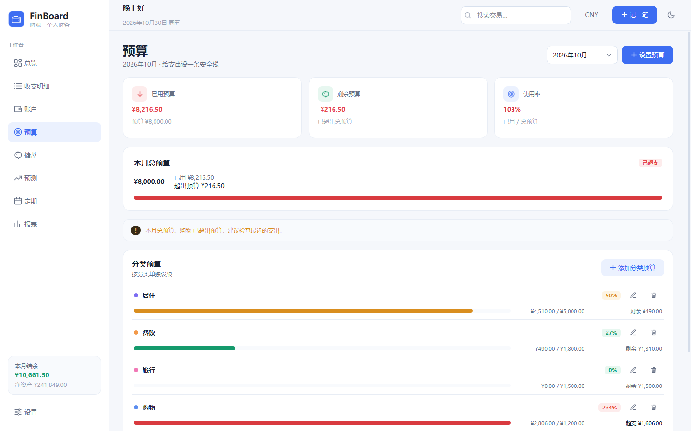

# FinBoard · 财观

> 一个专注本地数据、界面清爽的个人财务管理桌面应用。  
> A local-first personal finance desktop app with a clean, flat interface.

[中文](#中文) · [English](#english) · [MIT License](LICENSE)


---

## 中文

### 简介

FinBoard（财观）是一个用 **Python + PySide6（Qt 6）+ SQLite** 编写的个人财务管理软件。它把账户、收支、预算和报表放在一个桌面窗口里，所有账目只保存在本机。除每日从 Frankfurter 获取一次公开汇率外，程序不联网、不上传、不需要注册账号。

界面采用扁平化设计，提供浅色与深色两套主题；资产与负债的比例用自绘环形图展示，收支趋势、分类排行也全部由 `QPainter` 绘制，不依赖任何第三方图表库。

### 功能

- **总览**：净资产、本月收入/支出/结余、资产与负债百分比环图、近 6 个月趋势、最近记录、预算进度。
- **收支明细**：按月份、类型、账户、分类筛选，支持关键词搜索；双击编辑、右键删除、Delete 删除；CSV 导出。
- **账户**：现金、储蓄卡、投资理财、信用卡、贷款五类账户；每个账户可设自己的币种；实时余额由期初余额和流水聚合得出；信用卡/贷款按欠款金额（正数）录入，自动计入负债；支持归档与恢复。
- **投资市值**：投资理财账户可按日记录收盘总市值，账户余额自动变为「最新市值 + 市值日之后的流水」；带历史曲线、同日覆盖、删除重算，市值变动不计入收支。
- **多币种**：账户级 + 交易级币种；按每个交易日的汇率折算后汇总，周末和节假日沿用最近一个工作日；基准币种可切换，总览/报表/预算统一按基准币种显示。
- **钱包提现手续费**：从「支付宝钱包」或「微信钱包」转出时，按 0.1% 自动扣手续费（支付宝最低 ¥0.10，微信最低 ¥0.01）；手续费计入支出统计，报表中归入「提现手续费」。
- **汇率**：每日自动检查一次，也可在设置页手动刷新；数据来自 Frankfurter（欧洲央行参考汇率），缓存在本地，离线时继续使用最后一次汇率。
- **预算**：按月设置总预算和分类预算，实时显示已用、剩余、使用率；超支时用红色提示。
- **报表**：资产/负债结构、本月支出构成、近 12 个月趋势、支出分类排行、消费对象 Top 5。
- **记账**：支持支出、收入、账户间转账；可填写日期、金额、账户、分类、对方、备注。
- **分类管理**：自定义支出/收入分类名称与颜色；删除分类时，历史记录自动归入「其他」。
- **数据**：CSV 导入/导出、数据库备份、载入演示数据、清空全部数据。
- **体验**：浅色/深色主题一键切换、全局搜索、快捷键、卡片式扁平布局。

### 界面

| 总览（浅色） | 总览（深色） |
| --- | --- |
|  |  |

| 收支明细 | 账户 |
| --- | --- |
|  |  |

| 预算 | 报表 |
| --- | --- |
|  |  |

| 多币种明细 | 汇率与设置 |
| --- | --- |
|  |  |

| 投资账户 | 市值记录 |
| --- | --- |
|  |  |

更多截图在 [`docs/screenshots/`](docs/screenshots/)。

### 技术栈

| 层 | 选择 |
| --- | --- |
| 语言 | Python 3.10+ |
| GUI | PySide6 6.6+ / Qt 6 Widgets |
| 数据库 | SQLite（标准库 `sqlite3`） |
| 汇率 | Frankfurter（ECB 参考汇率）+ 本地缓存 |
| 图表 | 纯 `QPainter` 自绘（环图、折线图、条形图） |
| 样式 | QSS + `QPalette`，双主题 |
| 图标 | 内联 SVG，运行时着色 |
| 打包 | PyInstaller（Windows one-dir） |

运行时只依赖 PySide6。Pillow 只用于生成应用图标，PyInstaller 只用于构建 exe，二者都不是运行依赖。汇率请求使用标准库 `urllib`，没有额外的网络库。

### 快速开始

#### 1. 源码运行

```bash
git clone <this-repo> FinBoard
cd FinBoard

python -m venv .venv
# Windows
.venv\Scripts\activate
# macOS / Linux
# source .venv/bin/activate

pip install -r requirements.txt
python run.py
```

也可以：

```bash
python run.py --demo          # 使用独立的演示数据库
python run.py --reset-demo    # 重建演示数据并打开
python run.py --db D:\data\my.db
python run.py --theme dark
python -m finboard --version
```

首次启动会自动建库、写入默认分类和一个「现金」账户。若想直接看到完整效果，推荐运行 `python run.py --reset-demo`。

#### 2. 直接运行 exe

构建后的可执行文件位于：

```text
dist/FinBoard/FinBoard.exe
```

双击即可运行；整个 `dist/FinBoard/` 文件夹一起分发。也可以带参数：

```bat
dist\FinBoard\FinBoard.exe --demo
dist\FinBoard\FinBoard.exe --db D:\data\my.db
dist\FinBoard\FinBoard.exe --version
```

### 使用说明

1. **先更新汇率**：在「设置 → 汇率」点一次「更新汇率」。程序每天首次启动时会自动检查一次；外币账户、外币交易和基准币种切换都需要至少一次成功更新。
2. **建账户**：在「账户」页新建现金、银行卡、信用卡或贷款账户，选择账户币种，填入期初余额。信用卡、贷款请填写**欠款金额（正数）**，程序会自动转为负余额并计入负债；编辑旧账户保存时也会自动转换。账户一旦有流水，币种不可再改。
3. **记录投资市值**：投资理财账户行的折线图标打开「市值记录」。填入某个交易日的**收盘总市值**（账户币种），保存后余额 = 最新市值 + 该日期之后的收入/支出/转账净额；同日再次保存会覆盖。历史曲线和记录列表里可以删除旧快照，余额会立即重算。市值变化只影响账户余额和净资产，不计入当月收入或支出。
4. **记一笔**：点右上角「记一笔」或按 `Ctrl+N`，选择支出/收入/转账，填写金额、币种、账户和分类。交易币种可以和账户币种不同，程序按交易日期汇率折算入账，并在下方显示折算预览。转账会让转出账户减少、转入账户增加；跨币种转账可自动或手动填写「到账金额」。
   - 如果转出账户是「支付宝钱包」或「微信钱包」（也识别「支付宝」「微信」），程序会自动按提现金额的 0.1% 扣手续费：支付宝每笔最低 ¥0.10，微信每笔最低 ¥0.01。手续费从转出账户额外扣除，转入账户仍收到填写的金额；它会计入当月支出，但不会生成一条独立流水。
   - 规则按**账户名称**识别，仅对人民币钱包生效；改名后不再自动计费。
5. **设预算**：在「预算」页选择月份，先设置本月总预算，再给重点分类单独设上限。预算金额使用当前基准币种。
6. **看报表**：在「报表」页切换月份，查看资产/负债比例、支出结构和趋势；所有汇总按交易日汇率折算为基准币种。
7. **备份数据**：在「设置 → 数据」中备份数据库或导出 CSV。CSV 也可用于从其他软件迁移数据。

快捷键：

| 快捷键 | 动作 |
| --- | --- |
| `Ctrl+N` | 记一笔 |
| `Ctrl+F` | 全局搜索 |
| `Ctrl+,` | 设置 |
| `Ctrl+1` … `Ctrl+5` | 总览 / 收支明细 / 账户 / 预算 / 报表 |
| `Delete` | 删除选中的收支记录 |

### CSV 格式

导出文件使用 UTF-8（带 BOM），导入兼容 UTF-8 与 GB18030。表头固定为：

```csv
日期,类型,金额,币种,分类,账户,转入账户,到账金额,对方,备注
2026-10-01,支出,35.50,CNY,餐饮,微信钱包,,,瑞幸咖啡,早餐
2026-10-05,收入,18500.00,CNY,工资,招商银行储蓄卡,,,公司,10 月工资
2026-10-06,转账,1000.00,CNY,,人民币储蓄卡,美元储蓄卡,150.00,,购汇
2026-10-07,支出,12.00,USD,餐饮,美元储蓄卡,,,Amazon,美元消费
```

说明：

- 金额为**正数**，最多两位小数，不需要货币符号；`币种` 留空时按 `CNY` 处理。
- `类型` 可取 `支出`、`收入`、`转账`。
- 支出/收入必须填写分类；转账必须填写转入账户，分类留空。
- `到账金额` 只用于跨币种转账；留空时按交易日期汇率自动折算。外币交易和跨币种转账需要本地已有对应日期的汇率。
- 手续费是派生值，不单独占 CSV 列；导入钱包转账时按账户名、金额和日期重新计算。
- 导入前请先建好同名、同币种的账户和分类；无法识别的行会被跳过，并在结果中给出原因。

### 数据与隐私

默认数据目录：

```text
%LOCALAPPDATA%\FinBoard\
├── finboard.db        # 主数据库
├── finboard-demo.db   # --demo 使用的演示数据库
└── finboard.log       # 运行日志
```

- 可用环境变量 `FINBOARD_DATA_DIR` 改数据目录，或用 `FINBOARD_DB` 指定数据库文件。
- 若用户目录不可写（便携盘、受限环境），程序会自动回退到可执行文件旁的 `FinBoard-Data\finboard.db`，并在启动时提示。
- 账目全部保存在本地 SQLite 文件中。程序唯一的网络请求是向 Frankfurter 获取公开汇率；请求只包含目标币种列表，不包含任何账户、金额或个人信息。离线时继续使用本地缓存汇率。
- 备份方式：设置页「备份数据库」，或直接复制 `finboard.db`（建议先退出程序）。

### 项目结构

```text
finboard/
├── app.py                  # QApplication、参数、设置、数据库生命周期
├── core/
│   ├── money.py            # 整数分金额解析/格式化
│   ├── dates.py            # 月份与日期工具
│   ├── models.py           # dataclass 模型与常量
│   ├── database.py         # schema、迁移、默认数据
│   ├── repository.py       # SQL 查询、写入与多币种折算
│   ├── rates.py            # 汇率缓存、每日抓取与换算
│   ├── fees.py             # 支付宝/微信提现手续费规则
│   ├── csv_io.py           # CSV 导入/导出
│   ├── service.py          # 面向 UI 的服务层 + changed 信号
│   ├── demo.py             # 12 个月演示数据
│   └── paths.py            # 数据/资源路径（含 PyInstaller）
├── ui/
│   ├── theme.py            # 两套 Palette + QSS
│   ├── icons.py            # 内联 SVG 图标
│   ├── widgets.py          # Card、Badge、按钮、对话框基件
│   ├── charts.py           # 环形图、趋势图、分类条形图
│   ├── models.py           # 交易表模型与类型徽章代理
│   ├── rows.py             # 交易/账户列表行
│   ├── main_window.py      # 侧栏、顶栏、页面路由
│   ├── dialogs/            # 记账、账户、市值、分类、预算、分类管理
│   └── pages/              # 总览、明细、账户、预算、报表、设置
├── resources/              # 图标、勾选/下拉 SVG
└── __main__.py
tests/test_core.py          # 金额/日期/仓储/CSV/服务层测试
tests/test_rates.py         # 汇率、跨币种转账与币种 CSV 测试
tests/test_fees.py          # 钱包提现手续费与统计测试
tests/test_valuations.py    # 投资市值、快照后流水与余额锁定测试
tests/test_ui.py            # 账户/交易/市值对话框、自动更新汇率测试
scripts/                    # 冒烟、截图、图标生成
docs/                       # 截图与 logo
run.py                      # 源码入口
FinBoard.spec               # PyInstaller 构建配置
```

### 关键设计

- **整数分**：数据库与内存中的金额全部是 `int` 分，只在输入/显示边界转换，避免 `0.1 + 0.2` 类浮点误差。
- **多币种折算**：汇率以 `1 CNY = rate` 存表，跨币种经 CNY 中转；每笔交易保留原币金额、账户入账额和（转账）到账额，汇总时按交易日汇率折算，历史报表不会因今天的汇率变化而漂移。
- **余额不落库**：账户余额 = 期初余额 + 收入 − 支出 ± 转账，由 SQL 聚合实时计算；避免多写一份余额导致不一致。
- **转账双账户**：转账只存一条 `transactions` 记录，查询时同时计入转出和转入账户；报表统计收支时排除转账。
- **提现手续费**：转账记录多存一个 `fee`；钱包转出时由 `fees.py` 按账户名和折算后人民币金额计算，余额、月度统计和分类报表都会计入，CSV 导入时重新计算。
- **投资市值快照**：`account_valuations` 每个账户每日最多一条；最新快照接管余额，只叠加 `date > 快照日期` 的流水。市值变化不写入 `transactions`，因此不会伪装成收入或支出；删除快照后余额自动回到上一份快照或期初余额。
- **自绘图表**：环图、折线图、分类条全部在 `paintEvent` 中绘制，颜色取当前 Palette，主题切换即时重绘。
- **主题系统**：一个 `Palette` dataclass 驱动 QPalette、QSS 与图表；设置保存在 `QSettings`。
- **本地优先**：没有账号、云同步、遥测；只有每日一次公开汇率请求，失败不影响离线使用。

### 测试与构建

```bash
# 单元测试（48 个）
python -m unittest discover -s tests

# 核心冒烟（临时数据库、演示数据、CSV 往返）
python scripts/smoke_core.py

# 界面截图（浅色 / 深色）
python scripts/smoke_ui.py
python scripts/smoke_ui.py --theme dark

# 构建 Windows exe
pip install -r requirements-dev.txt
python -m PyInstaller FinBoard.spec --noconfirm --clean
```

构建产物：`dist/FinBoard/FinBoard.exe`（one-dir，整个文件夹一起分发）。

### 已知限制

- 汇率来自 Frankfurter（ECB 参考汇率），不含周末/节假日单独报价；周末交易沿用最近一个工作日。若交易日期早于本地最早汇率，会退回到最早一条，建议外币记账前先更新汇率。
- 市值记录只对投资理财账户开放。快照按“当日收盘后的总市值”理解：快照日及之前的流水视为已包含在市值里，只有快照日之后的收支/转账才会叠加到余额。
- 基准币种切换只改变汇总显示，不会改写已有预算金额，切换后请复核预算。
- 提现手续费只对账户名为「支付宝钱包 / 微信钱包」（或「支付宝 / 微信」）的人民币账户自动计算；改名或使用其他名称不会计费。手续费规则是内置的，不随支付宝/微信官方调整自动更新。
- 单用户、单机；没有登录、加密或云同步。
- 预算按自然月设置，不跨月结转。
- 不直接连接银行/支付宝/微信账单，需通过 CSV 导入。
- one-dir 包没有单文件自解压步骤；请保持 `FinBoard.exe` 与 `_internal` 目录的相对位置。

### 许可证

[MIT](LICENSE) © 2026 Urtaome0211

---

## English

### Overview

**FinBoard** is a personal finance desktop application built with **Python, PySide6 (Qt 6) and SQLite**. Accounts, transactions, budgets and reports live in one native window. Your books stay on your machine: no account, no cloud, no telemetry. The only network request is a daily public exchange-rate lookup from Frankfurter.

The interface is flat and calm, with light and dark themes. The asset/liability split is rendered as a custom donut chart, and all trend and category charts are drawn with `QPainter` — no third-party charting library.

### Features

- **Dashboard**: net worth, monthly income/expense/balance, asset-vs-liability donut, 6-month trend, recent transactions and budget progress.
- **Transactions**: filter by month, kind, account and category; search by payee/note; edit, delete, export to CSV.
- **Accounts**: cash, debit card, investment, credit card and loan accounts, each with its own currency. Balances are aggregated from the opening balance and transactions in real time. Archive and restore are supported.
- **Investment valuations**: record a closing market value per day for investment accounts. The balance becomes “latest snapshot + later transactions”, with a history chart, same-day overwrite and delete-to-recalculate. Market moves are not counted as income or expense.
- **Multi-currency**: account-level and transaction-level currencies. Amounts are converted at the transaction-date rate, with weekend/holiday fallback to the latest business day. The base currency can be switched; dashboard, reports and budgets are shown in it.
- **Wallet withdrawal fees**: transfers out of “支付宝钱包” or “微信钱包” automatically add a 0.1% fee (minimum ¥0.10 for Alipay, ¥0.01 for WeChat). The fee is counted as an expense and grouped under “提现手续费” in reports.
- **Rates**: one automatic check per day plus a manual refresh in Settings. Data comes from Frankfurter (ECB reference rates) and is cached locally, so offline use keeps the last known rates.
- **Budgets**: per-month overall and per-category limits, with spent/remaining/usage and over-budget warnings.
- **Reports**: asset/liability structure, monthly expense composition, 12-month trend, category ranking and top payees.
- **Bookkeeping**: expenses, income and account-to-account transfers with date, amount, account, category, payee and note.
- **Categories**: custom names and colors; deleting a category moves its history to “Other”.
- **Data tools**: CSV import/export, database backup, demo data and full reset.
- **Experience**: light/dark theme, global search, keyboard shortcuts, flat card layout.

### Screenshots

| Dashboard (light) | Dashboard (dark) |
| --- | --- |
|  |  |

| Transactions | Accounts |
| --- | --- |
|  |  |

| Budgets | Reports |
| --- | --- |
|  |  |

| Multi-currency transactions | Rates & settings |
| --- | --- |
|  |  |

| Investment accounts | Valuation history |
| --- | --- |
|  |  |


### Tech stack

| Layer | Choice |
| --- | --- |
| Language | Python 3.10+ |
| GUI | PySide6 6.6+ / Qt 6 Widgets |
| Storage | SQLite via the standard `sqlite3` module |
| FX rates | Frankfurter (ECB reference rates) + local cache |
| Charts | Custom `QPainter` (donut, line, bars) |
| Styling | QSS + `QPalette`, two themes |
| Icons | Inline SVG, tinted at runtime |
| Packaging | PyInstaller (Windows one-dir) |

PySide6 is the only runtime dependency. Pillow is used only to generate the app icon and PyInstaller only to build the executable. Rate requests use the standard-library `urllib`, with no extra networking package.

### Quick start

#### From source

```bash
git clone <this-repo> FinBoard
cd FinBoard

python -m venv .venv
# Windows
.venv\Scripts\activate
# macOS / Linux
# source .venv/bin/activate

pip install -r requirements.txt
python run.py
```

Useful options:

```bash
python run.py --demo          # isolated demo database
python run.py --reset-demo    # rebuild demo data, then open
python run.py --db D:\data\my.db
python run.py --theme dark
python -m finboard --version
```

The first launch creates the database, default categories and a “Cash” account. For a fully populated tour, run `python run.py --reset-demo`.

#### Prebuilt executable

```text
dist/FinBoard/FinBoard.exe
```

Double-click it, or pass the same flags (ship the whole `dist/FinBoard/` folder):

```bat
dist\FinBoard\FinBoard.exe --demo
dist\FinBoard\FinBoard.exe --db D:\data\my.db
dist\FinBoard\FinBoard.exe --version
```

### How to use

1. **Update rates first** in Settings → Rates. The app also checks once on the first launch of each day. Foreign-currency accounts, foreign-currency transactions and base-currency switches need at least one successful update.
2. **Create accounts** on the Accounts page. Pick a currency and enter an opening balance; use a **positive debt amount** for credit cards and loans — the app stores it as a negative balance and counts it as a liability. A currency cannot be changed once the account has transactions.
3. **Add a transaction** with `Ctrl+N` or the “Add” button. Pick expense, income or transfer, then amount, currency, account and category. The transaction currency may differ from the account currency; the app converts at the transaction date and previews the posting. A transfer decreases the source account and increases the destination account; cross-currency transfers accept an optional destination amount.
   - If the source account is “支付宝钱包” or “微信钱包” (or simply “支付宝”/“微信”), FinBoard adds a 0.1% withdrawal fee automatically: at least ¥0.10 for Alipay and ¥0.01 for WeChat. The fee is deducted from the source account on top of the transfer; the destination still receives the amount you entered. It counts as an expense but does not create a separate transaction row.
   - Fees are keyed by account name and only apply to CNY wallets; renaming the wallet disables the rule.
4. **Set budgets** on the Budgets page: an overall monthly limit first, then optional category limits. Budgets use the current base currency.
5. **Review reports** on the Reports page; switch months to compare. All totals are converted to the base currency at each transaction's date.
6. **Back up** from Settings → Data (database copy or CSV export).

Shortcuts:

| Shortcut | Action |
| --- | --- |
| `Ctrl+N` | New transaction |
| `Ctrl+F` | Global search |
| `Ctrl+,` | Settings |
| `Ctrl+1` … `Ctrl+5` | Dashboard / Transactions / Accounts / Budgets / Reports |
| `Delete` | Delete selected transaction |

### CSV format

Exports are UTF-8 with BOM; imports accept UTF-8 and GB18030. The header is fixed:

```csv
日期,类型,金额,币种,分类,账户,转入账户,到账金额,对方,备注
2026-10-01,支出,35.50,CNY,餐饮,微信钱包,,,瑞幸咖啡,早餐
2026-10-05,收入,18500.00,CNY,工资,招商银行储蓄卡,,,公司,October salary
2026-10-06,转账,1000.00,CNY,,人民币储蓄卡,美元储蓄卡,150.00,,FX transfer
2026-10-07,支出,12.00,USD,餐饮,美元储蓄卡,,,Amazon,USD purchase
```

- Amounts are **positive**, at most two decimals, no currency symbol. An empty currency means `CNY`.
- Kind is `支出` (expense), `收入` (income) or `转账` (transfer).
- Expenses/income need a category; transfers need a destination account and no category.
- `到账金额` (destination amount) is only for cross-currency transfers; leave it blank to convert automatically at the transaction-date rate. Foreign transactions need a cached rate for that date.
- Fees are derived, not a CSV column: importing a wallet transfer recalculates the fee from the account name, amount and date.
- Create matching accounts (same currency) and categories first. Invalid rows are skipped and reported.

### Data & privacy

Default location on Windows:

```text
%LOCALAPPDATA%\FinBoard\
├── finboard.db        # main database
├── finboard-demo.db   # demo database used by --demo
└── finboard.log       # runtime log
```

- Override the data directory with `FINBOARD_DATA_DIR`, or the database file with `FINBOARD_DB`.
- If the profile directory is not writable (portable drive or restricted machine), the app falls back to `FinBoard-Data\finboard.db` beside the executable and shows a notice at startup.
- All books live in a local SQLite file. The only network request fetches public exchange rates from Frankfurter; it contains the requested currency codes and no account, amount or personal information. When offline, the last cached rates remain usable.
- Back up from Settings → Data, or copy `finboard.db` while the app is closed.

### Design notes

- **Integer cents**: every stored amount is an `int` number of cents; conversion happens only at input/output boundaries.
- **Multi-currency conversion**: rates are stored as `1 CNY = rate` and cross-rates go through CNY. Each transaction keeps its original amount, account posting amount and (for transfers) destination amount; reports convert at the transaction date, so history does not drift with today's rate.
- **Derived balances**: an account balance is opening balance + income − expenses ± transfers, aggregated by SQL. No duplicated balance column to drift out of sync.
- **Transfers**: one transaction row feeds both the source and destination accounts; reports exclude transfers from income/expense.
- **Withdrawal fees**: the transaction row keeps a derived `fee`; `fees.py` computes it from the wallet name and the CNY posting amount. Balances, monthly stats and category reports include it; CSV imports recalculate it.
- **Custom charts**: donut, trend and category bars are painted in `paintEvent` with palette colors and repaint on theme changes.
- **Theme system**: a single `Palette` dataclass drives QPalette, QSS and charts; the choice is stored in `QSettings`.
- **Local-first**: no login, sync or telemetry; only one daily public rate request, and failures never block offline use.

### Testing & build

```bash
# 48 unit tests
python -m unittest discover -s tests

# Core smoke test (temporary DB, demo data, CSV round-trip)
python scripts/smoke_core.py

# UI screenshots (light / dark)
python scripts/smoke_ui.py
python scripts/smoke_ui.py --theme dark

# Windows executable
pip install -r requirements-dev.txt
python -m PyInstaller FinBoard.spec --noconfirm --clean
```

Output: `dist/FinBoard/FinBoard.exe` (one-dir; ship the whole folder).

### Known limitations

- Rates come from Frankfurter (ECB reference rates) and have no separate weekend/holiday quotes; weekend transactions use the latest business day. A transaction dated before the earliest cached rate falls back to that earliest rate, so update rates before backfilling foreign transactions.
- Valuations are available for investment accounts only. A snapshot is treated as the post-close value: transactions dated on or before that day are considered already reflected in it, while later flows adjust the balance.
- Switching the base currency changes aggregation display only; existing budget amounts are not rewritten, so review them after switching.
- Withdrawal fees are calculated only for CNY accounts named “支付宝钱包 / 微信钱包” (or “支付宝 / 微信”). Renaming an account or using a different name disables the rule. The rates are built in and do not update when Alipay/WeChat change their policy.
- Single-user, single-machine: no login, encryption or cloud sync.
- Budgets are per calendar month and do not roll over.
- No direct bank/Alipay/WeChat sync; use CSV import.
- The one-dir build has no self-extraction step; keep `FinBoard.exe` beside its `_internal` folder.

### License

[MIT](LICENSE) © 2026 Urtaome0211
